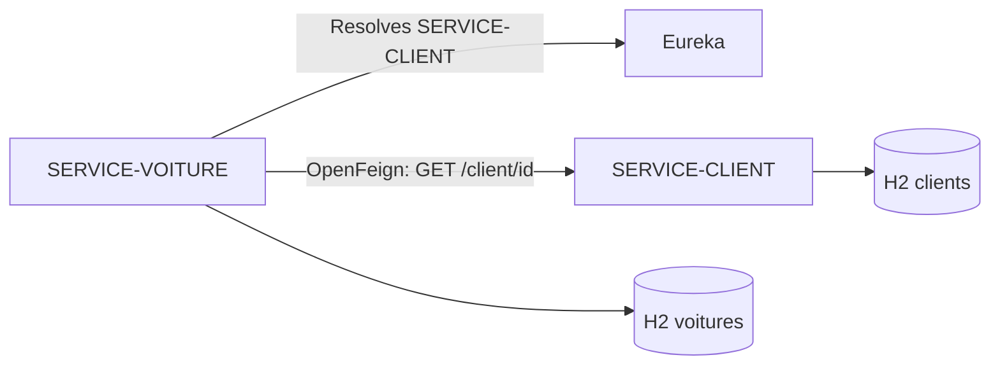
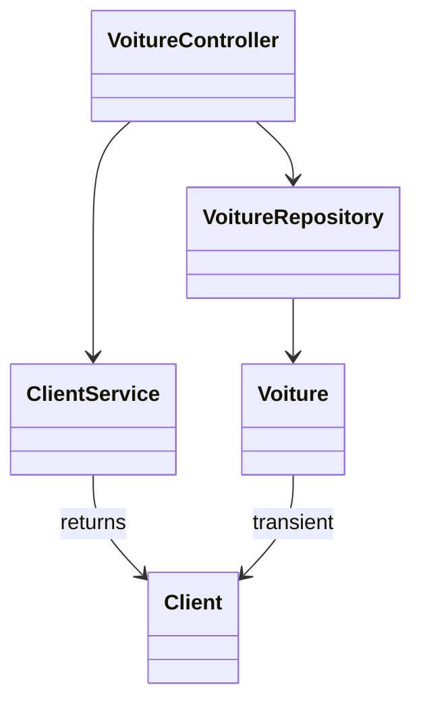

# Lab 19 — Étape 6: Gateway avec Eureka

With Java 17 and Maven, run `mvn clean package` from this folder. Stop any
previous IntelliJ runs and reload Maven so the Gateway picks up its new dependencies.
Start these commands in separate terminals, in order:

```powershell
java -jar eureka-server/target/eureka-server-1.0-SNAPSHOT.jar
java -jar client/target/client-1.0-SNAPSHOT.jar
java -jar gateway/target/gateway-1.0-SNAPSHOT.jar
```

1. Open http://localhost:8761/ and look for SERVICE-CLIENT and GATEWAY.
2. Open http://localhost:8888/clients and http://localhost:8888/client/1.
   The Gateway resolves SERVICE-CLIENT in Eureka and forwards the original path.
   If you just launched the services, give the Gateway up to a minute to refresh its registry and retry.
3. For the report, capture the Eureka dashboard and the Gateway's client list.

The Gateway uses the MVC equivalent of the handout's WebFlux route bean:
`lb("SERVICE-CLIENT")`. The former static routes are archived in `app.yml`,
which Spring Boot does not load by default. No MySQL or Docker is needed.

With the applications stopped, run
`powershell -ExecutionPolicy Bypass -File ./verify.ps1` after packaging.
The check runs Client on port 18088 to prove the Gateway uses discovery.

## Étape 7: SERVICE-VOITURE

After `mvn clean package`, start Eureka and Client, then start Voiture:

```powershell
java -jar service-voiture/target/service-voiture-1.0-SNAPSHOT.jar
```

Open http://localhost:8089/voitures. Expect three cars with nested client
details: Toyota and Renault belong to Rabab SELIMANI, and Peugeot belongs
to Amal RAMI. Take screenshots of that JSON and SERVICE-VOITURE as UP on
the Eureka dashboard. Both services use separate in-memory H2 databases.





The stored relationship is `clientId`; Client is a remote POJO, so the
enriched field is `@Transient`. Feign calls the existing singular
`/client/{id}` endpoint. The seed does not depend on remote calls.

## Étapes 8–10: Voiture API and final checks

Rebuild with `mvn clean package` after stopping old runs, then launch
Eureka, Client, Voiture and Gateway in separate terminals.

| Screenshot | URL | Expected result |
|---|---|---|
| Eureka | http://localhost:8761/ | SERVICE-CLIENT, SERVICE-VOITURE and GATEWAY are UP |
| Clients through Gateway | http://localhost:8888/clients | Three clients |
| Cars through Gateway | http://localhost:8888/voitures | Three cars, with their owners |
| Car detail | http://localhost:8089/voitures/1 | Toyota Corolla, owned by Rabab SELIMANI |
| Cars by client | http://localhost:8089/voitures/client/1 | Toyota and Renault |

The Gateway also forwards the detail and owner-filter URLs under port 8888.
To demonstrate writes, send JSON with an HTTP client such as PowerShell:

```powershell
$car = Invoke-RestMethod http://localhost:8888/voitures/2 -Method Post -ContentType 'application/json' -Body '{"marque":"Dacia","matricule":"LAB-19","model":"Logan"}'
Invoke-RestMethod "http://localhost:8888/voitures/$($car.id)" -Method Put -ContentType 'application/json' -Body '{"model":"Sandero"}'
```

POST uses the client ID in the URL. PUT changes only supplied, nonblank
vehicle fields and leaves the owner unchanged. H2 resets when Voiture restarts.
